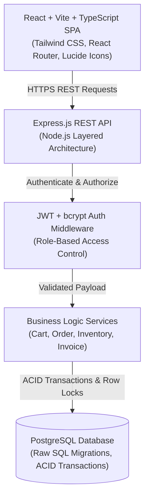
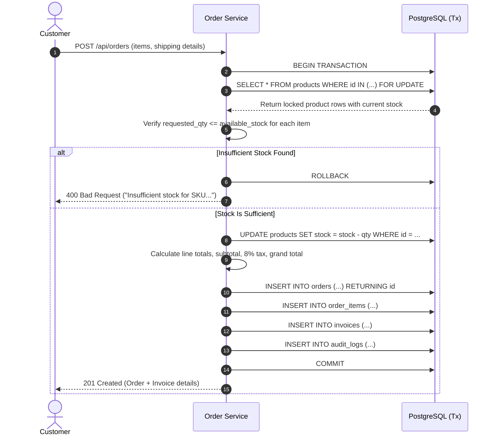

# Project 1: B2B Order Management Platform - Architecture Plan

## 1. System Overview

The **B2B Order Management Platform** employs a decoupled client-server architecture:
* **Frontend**: A Single Page Application (SPA) built with React 18, Vite, TypeScript, and Tailwind CSS. It communicates with the backend via a type-safe API client with central error handling, toast notifications, and auth persistence.
* **Backend**: A modular RESTful API built on Node.js and Express.js, following a strict layered architecture (Routes → Controllers → Services → Data Access / Database Pool).
* **Database**: PostgreSQL with transactional isolation (`READ COMMITTED` with selective row-level `FOR UPDATE` locks), foreign key constraints, check constraints, and indexed lookups.



---

## 2. Layered Backend Architecture

To ensure high maintainability and testability, the backend is organized into 5 distinct layers:

1. **Routing Layer (`src/routes/`)**: Declares API URL paths and attaches middleware (validation, authentication, authorization).
2. **Middleware Layer (`src/middleware/`)**:
   * `authMiddleware`: Extracts Bearer token, verifies JWT signature, and attaches `req.user`.
   * `roleMiddleware`: Ensures caller has the required role (`admin` or `customer`).
   * `validateMiddleware`: Validates request schemas using Zod or custom validators before controllers execute.
   * `errorHandler`: Centralized error handling returning structured JSON errors.
3. **Controller Layer (`src/controllers/`)**: Extracts HTTP params/body, coordinates service calls, and formats standard HTTP responses (`200 OK`, `201 Created`, etc.).
4. **Service Layer (`src/services/`)**: Implements core business rules (e.g., pricing recalculation, transaction coordination, stock availability checks, audit log generation).
5. **Database / Repository Layer (`src/db/`)**: Manages the PostgreSQL connection pool (`pg.Pool`), transaction execution helpers, and SQL queries.

---

## 3. Concurrency & Transaction Management

Wholesale orders contain high quantities across multiple SKUs. To eliminate race conditions where two customers attempt to purchase the same inventory simultaneously, order checkout follows an atomic lock pattern:



---

## 4. Directory & Project Structure

The project is structured with clean separation between backend and frontend:

```
project-1-b2b-order-platform/
├── backend/
│   ├── src/
│   │   ├── config/             # DB connection, environment variables
│   │   ├── controllers/        # Request handling and HTTP status responses
│   │   ├── db/                 # Migration runner, seed scripts, SQL files
│   │   │   ├── migrations/     # Versioned SQL migration files (001_..., 002_...)
│   │   │   └── seeds/          # Sample products, customers, admins
│   │   ├── middleware/         # Auth, RBAC, input validation, error handling
│   │   ├── routes/             # Express route definitions
│   │   ├── services/           # Business logic (order processing, invoicing)
│   │   ├── utils/              # Token generation, password hashing, logger
│   │   └── app.js              # Express app setup and middleware registration
│   ├── tests/                  # Integration and unit tests
│   ├── .env.example
│   ├── package.json
│   └── server.js               # Server entry point
│
├── frontend/
│   ├── src/
│   │   ├── api/                # Axios/Fetch API client and endpoint functions
│   │   ├── components/         # Reusable UI components (Navbar, Modal, Alert, etc.)
│   │   ├── context/            # AuthContext, CartContext
│   │   ├── pages/              # Route pages (Catalog, Orders, Invoices, AdminDashboard)
│   │   ├── types/              # TypeScript interfaces and types
│   │   ├── App.tsx             # Root router & route guards
│   │   └── main.tsx            # React DOM mounting
│   ├── index.html
│   ├── package.json
│   ├── tsconfig.json
│   ├── vite.config.ts
│   └── tailwind.config.js
│
├── docs/                       # Architecture, requirements, API docs, schema
├── README.md
└── docker-compose.yml          # Optional local PostgreSQL runner
```

---

## 5. Security & Isolation Architecture

1. **Authentication**: JWT signed with a secret (`JWT_SECRET`) with configurable expiry (e.g. 24h).
2. **Password Storage**: Passwords hashed with `bcryptjs` using 10 rounds of salt.
3. **Data Isolation**: 
   * When a customer queries orders (`GET /api/orders`), the query is parameterized with `WHERE customer_id = $1`.
   * When fetching a specific order (`GET /api/orders/:id`), the service verifies `order.customer_id === req.user.id || req.user.role === 'admin'`.
4. **Injection Prevention**: All SQL queries use strictly parameterized inputs (`$1, $2, ...`), preventing SQL injection attacks.
