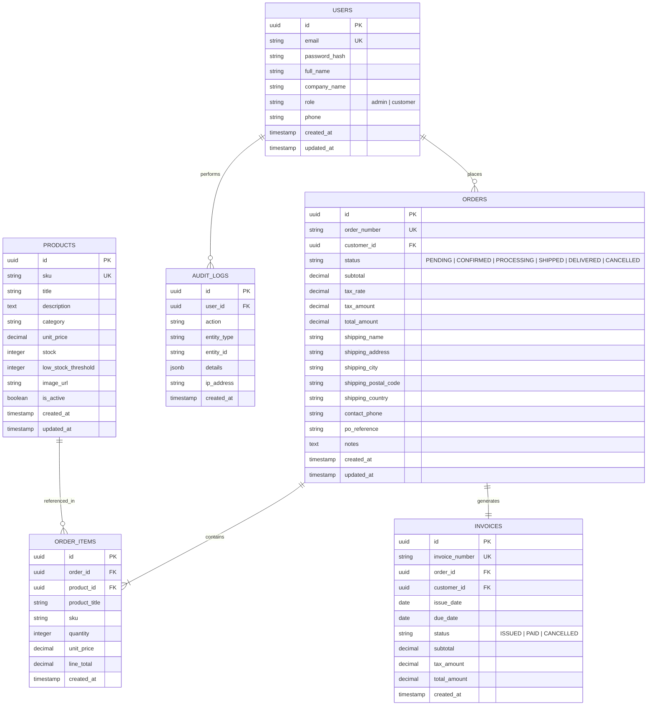

# Project 1: B2B Order Management Platform - Database Schema & Migrations

## 1. Entity-Relationship Overview

---

## 2. Table Specifications & Constraints

### 2.1 `users`
* `id` UUID PRIMARY KEY DEFAULT gen_random_uuid()
* `email` VARCHAR(255) UNIQUE NOT NULL
* `password_hash` VARCHAR(255) NOT NULL
* `full_name` VARCHAR(150) NOT NULL
* `company_name` VARCHAR(200) NOT NULL
* `role` VARCHAR(20) NOT NULL CHECK (role IN ('admin', 'customer')) DEFAULT 'customer'
* `phone` VARCHAR(50)
* `created_at` TIMESTAMPTZ NOT NULL DEFAULT NOW()
* `updated_at` TIMESTAMPTZ NOT NULL DEFAULT NOW()

### 2.2 `products`
* `id` UUID PRIMARY KEY DEFAULT gen_random_uuid()
* `sku` VARCHAR(100) UNIQUE NOT NULL
* `title` VARCHAR(255) NOT NULL
* `description` TEXT
* `category` VARCHAR(100) NOT NULL
* `unit_price` NUMERIC(12, 2) NOT NULL CHECK (unit_price >= 0)
* `stock` INT NOT NULL CHECK (stock >= 0) DEFAULT 0
* `low_stock_threshold` INT NOT NULL DEFAULT 10
* `image_url` TEXT
* `is_active` BOOLEAN NOT NULL DEFAULT TRUE
* `created_at` TIMESTAMPTZ NOT NULL DEFAULT NOW()
* `updated_at` TIMESTAMPTZ NOT NULL DEFAULT NOW()

### 2.3 `orders`
* `id` UUID PRIMARY KEY DEFAULT gen_random_uuid()
* `order_number` VARCHAR(50) UNIQUE NOT NULL
* `customer_id` UUID NOT NULL REFERENCES users(id) ON DELETE RESTRICT
* `status` VARCHAR(20) NOT NULL CHECK (status IN ('PENDING', 'CONFIRMED', 'PROCESSING', 'SHIPPED', 'DELIVERED', 'CANCELLED')) DEFAULT 'PENDING'
* `subtotal` NUMERIC(12, 2) NOT NULL CHECK (subtotal >= 0)
* `tax_rate` NUMERIC(5, 4) NOT NULL DEFAULT 0.0800
* `tax_amount` NUMERIC(12, 2) NOT NULL CHECK (tax_amount >= 0)
* `total_amount` NUMERIC(12, 2) NOT NULL CHECK (total_amount >= 0)
* `shipping_name` VARCHAR(150) NOT NULL
* `shipping_address` TEXT NOT NULL
* `shipping_city` VARCHAR(100) NOT NULL
* `shipping_postal_code` VARCHAR(50) NOT NULL
* `shipping_country` VARCHAR(100) NOT NULL DEFAULT 'United States'
* `contact_phone` VARCHAR(50) NOT NULL
* `po_reference` VARCHAR(100)
* `notes` TEXT
* `created_at` TIMESTAMPTZ NOT NULL DEFAULT NOW()
* `updated_at` TIMESTAMPTZ NOT NULL DEFAULT NOW()

### 2.4 `order_items`
* `id` UUID PRIMARY KEY DEFAULT gen_random_uuid()
* `order_id` UUID NOT NULL REFERENCES orders(id) ON DELETE CASCADE
* `product_id` UUID NOT NULL REFERENCES products(id) ON DELETE RESTRICT
* `product_title` VARCHAR(255) NOT NULL
* `sku` VARCHAR(100) NOT NULL
* `quantity` INT NOT NULL CHECK (quantity > 0)
* `unit_price` NUMERIC(12, 2) NOT NULL CHECK (unit_price >= 0)
* `line_total` NUMERIC(12, 2) NOT NULL CHECK (line_total >= 0)
* `created_at` TIMESTAMPTZ NOT NULL DEFAULT NOW()

### 2.5 `invoices`
* `id` UUID PRIMARY KEY DEFAULT gen_random_uuid()
* `invoice_number` VARCHAR(50) UNIQUE NOT NULL
* `order_id` UUID NOT NULL UNIQUE REFERENCES orders(id) ON DELETE CASCADE
* `customer_id` UUID NOT NULL REFERENCES users(id) ON DELETE RESTRICT
* `issue_date` DATE NOT NULL DEFAULT CURRENT_DATE
* `due_date` DATE NOT NULL
* `status` VARCHAR(20) NOT NULL CHECK (status IN ('ISSUED', 'PAID', 'CANCELLED')) DEFAULT 'ISSUED'
* `subtotal` NUMERIC(12, 2) NOT NULL
* `tax_amount` NUMERIC(12, 2) NOT NULL
* `total_amount` NUMERIC(12, 2) NOT NULL
* `created_at` TIMESTAMPTZ NOT NULL DEFAULT NOW()

### 2.6 `audit_logs`
* `id` UUID PRIMARY KEY DEFAULT gen_random_uuid()
* `user_id` UUID REFERENCES users(id) ON DELETE SET NULL
* `action` VARCHAR(100) NOT NULL
* `entity_type` VARCHAR(50) NOT NULL
* `entity_id` VARCHAR(100)
* `details` JSONB
* `ip_address` VARCHAR(50)
* `created_at` TIMESTAMPTZ NOT NULL DEFAULT NOW()

---

## 3. Database Indexes

To maintain high query performance under enterprise load:
* `CREATE INDEX idx_products_category ON products(category);`
* `CREATE INDEX idx_products_sku ON products(sku);`
* `CREATE INDEX idx_orders_customer_id ON orders(customer_id);`
* `CREATE INDEX idx_orders_status ON orders(status);`
* `CREATE INDEX idx_order_items_order_id ON order_items(order_id);`
* `CREATE INDEX idx_invoices_order_id ON invoices(order_id);`
* `CREATE INDEX idx_invoices_customer_id ON invoices(customer_id);`
* `CREATE INDEX idx_audit_logs_created_at ON audit_logs(created_at DESC);`

---

## 4. Migration Strategy
Migrations are managed as ordered SQL scripts located in `src/db/migrations/`:
* `001_initial_schema.sql`: Extensions (`pgcrypto`), core tables, constraints, and indexes.
* `002_audit_and_triggers.sql`: Triggers for `updated_at` automation.
* `003_seed_data.sql`: Seed data for demo accounts (Admin & Customer) and initial wholesale product catalog.

A custom migration runner script (`src/db/migrate.js`) records applied migrations in a `schema_migrations` table to guarantee idempotent execution.
